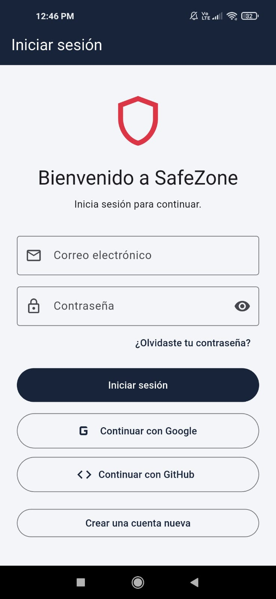
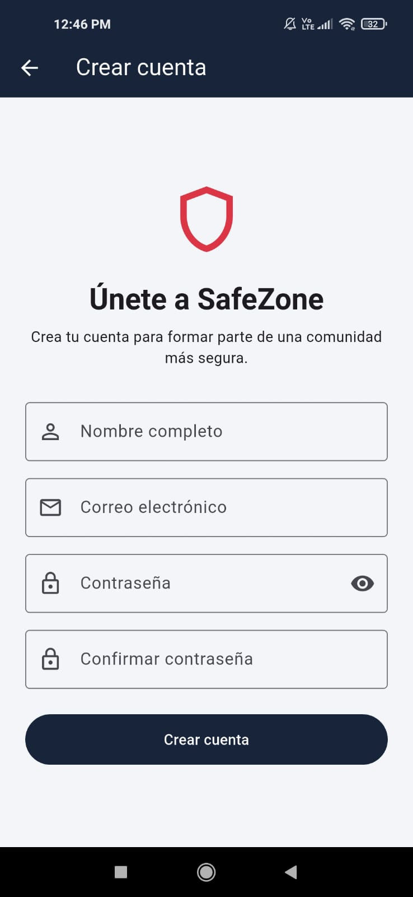
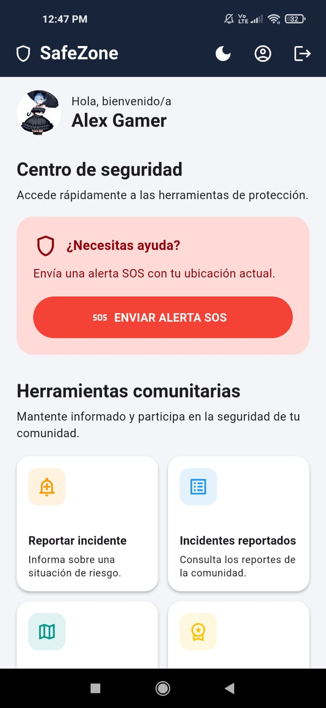
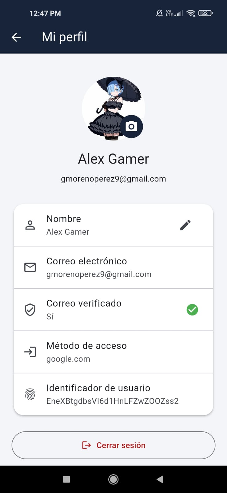
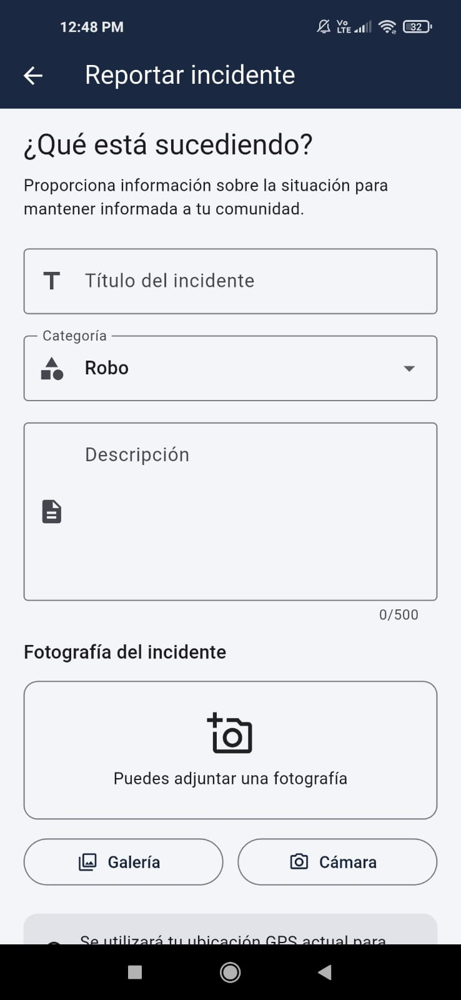
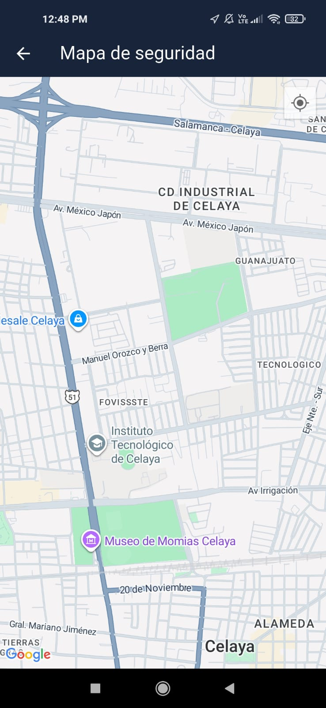
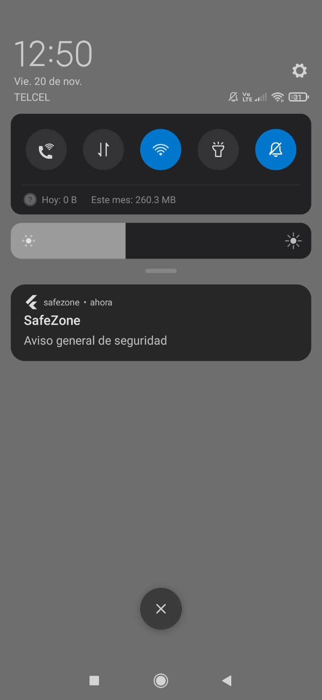
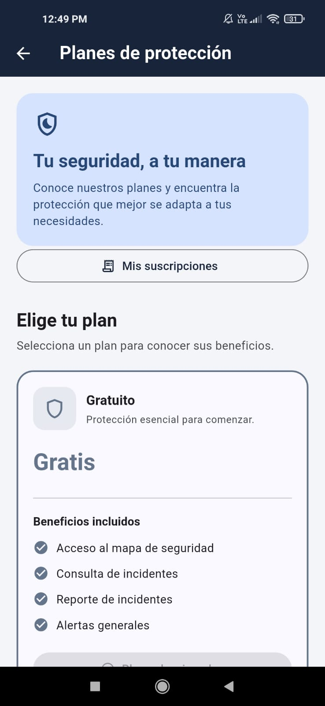
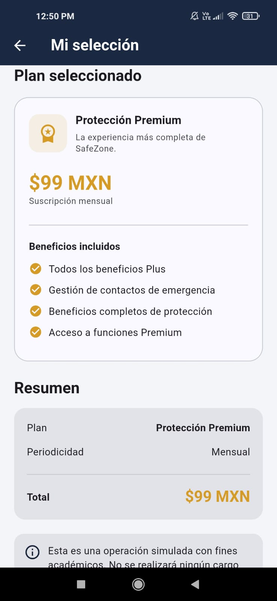
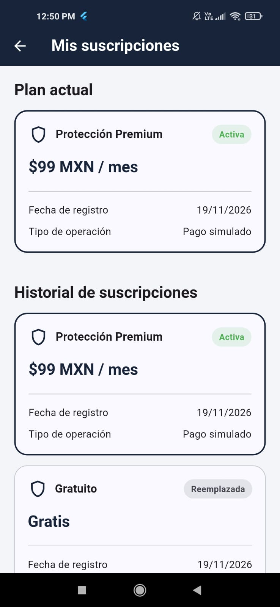

# SafeZone
### Aplicación móvil de seguridad comunitaria

SafeZone es una aplicación móvil desarrollada con **Flutter y Dart**, la cual permite proporcionar herramientas de apoyo para la seguridad comunitaria mediante el registro y consulta de incidentes, visualización de ubicaciones geográficas y recepción de notificaciones.

El proyecto integra servicios de Firebase para la autenticación y administración de información, además de diferentes componentes del dispositivo móvil para ofrecer una experiencia funcional y accesible.

---

## Índice

1. [Planteamiento del proyecto](#1-planteamiento-del-proyecto)
2. [Objetivos](#2-objetivos)
3. [Arquitectura de software](#3-arquitectura-de-software)
4. [Tecnologías y herramientas](#4-tecnologías-y-herramientas)
5. [Sensores y componentes del dispositivo](#5-sensores-y-componentes-del-dispositivo)
6. [Funcionalidades principales](#6-funcionalidades-principales)
7. [Base de datos y servicios en la nube](#7-base-de-datos-y-servicios-en-la-nube)
8. [Proceso de desarrollo](#8-proceso-de-desarrollo)
9. [Pruebas y validación](#9-pruebas-y-validación)
10. [Instalación y ejecución](#10-instalación-y-ejecución)
11. [Conclusiones](#11-conclusiones)

---

## 1. Planteamiento del proyecto

### Problemática

La seguridad comunitaria requiere herramientas que permitan a las personas compartir información sobre incidentes y mantenerse informadas acerca de situaciones que ocurren en su entorno.

La falta de mecanismos accesibles para reportar incidentes de forma eficiente y rapida, consultar su ubicación y recibir avisos puede dificultar el conocimiento oportuno de acontecimientos relevantes para una comunidad.

Ante esta situación, se propone el desarrollo de SafeZone, una aplicación móvil que concentra diferentes herramientas de apoyo para la seguridad comunitaria.

### Propuesta de solución

SafeZone proporciona una plataforma móvil en la que los usuarios pueden registrarse, administrar su perfil, reportar incidentes, consultar información geográfica y recibir notificaciones.

Además, incorpora un sistema de planes y suscripciones que permite demostrar la administración de servicios adicionales dentro de una aplicación móvil.

## 2. Objetivos

### Objetivo general

Desarrollar una aplicación móvil que facilite el registro y consulta de incidentes comunitarios, la visualización de información geográfica y la recepción de notificaciones, mediante el uso de Flutter y servicios en la nube.

### Objetivos específicos

- Implementar un sistema de autenticación de usuarios.
- Administrar perfiles mediante Firebase Authentication y Cloud Firestore.
- Permitir el registro y consulta de incidentes.
- Incorporar mapas para la visualización de ubicaciones.
- Implementar notificaciones push y locales.
- Integrar servicios de almacenamiento de imágenes.
- Desarrollar un catálogo de planes y un sistema de suscripciones.
- Implementar una interfaz adaptable con temas claro y oscuro.

## 3. Arquitectura de software

El proyecto utiliza una arquitectura modular basada en funcionalidades (*Feature-Based Architecture*), que permite organizar el código de acuerdo con las características principales de la aplicación.

Cada módulo contiene sus propias pantallas, proveedores de estado y servicios de datos, facilitando el mantenimiento y la ampliación del proyecto.

### Estructura del proyecto

```text
lib/
├── core/
│   ├── constants/
│   ├── router/
│   ├── services/
│   └── theme/
│
├── features/
│   ├── authentication/
│   │   ├── data/
│   │   ├── providers/
│   │   ├── screens/
│   │   └── widgets/
│   │
│   ├── dashboard/
│   │   ├── data/
│   │   ├── providers/
│   │   └── screens/
│   │
│   ├── incidents/
│   │   ├── data/
│   │   ├── providers/
│   │   └── screens/
│   │
│   ├── map/
│   │   ├── data/
│   │   ├── providers/
│   │   └── screens/
│   │
│   ├── notifications/
│   │   ├── data/
│   │   └── providers/
│   │
│   ├── profile/
│   │   ├── data/
│   │   ├── providers/
│   │   └── screens/
│   │
│   ├── store/
│   │   └── screens/
│   │
│   └── subscriptions/
│       ├── data/
│       └── screens/
│
├── models/
├── providers/
└── shared/
    ├── services/
    └── widgets/
```

### Administración del estado

Se utiliza **Riverpod** para administrar el estado de la aplicación y proporcionar acceso a los diferentes servicios.

Entre sus responsabilidades se encuentran:

- Gestionar el estado de autenticación.
- Proporcionar acceso a los servicios de datos.
- Administrar las preferencias de apariencia.
- Compartir información entre las diferentes pantallas.

### Navegación

La aplicación utiliza navegación entre pantallas para acceder a las diferentes funcionalidades. También incorpora un mecanismo de navegación para dirigir al usuario a la sección correspondiente cuando interactúa con una notificación.

---

## 4. Tecnologías y herramientas

| Tecnología | Implementación |
|---|---|
| Flutter | Desarrollo de la aplicación móvil. |
| Dart | Lenguaje de programación. |
| Firebase Core | Inicialización de Firebase. |
| Firebase Authentication | Autenticación de usuarios. |
| Cloud Firestore | Almacenamiento de perfiles, incidentes y suscripciones. |
| Firebase Cloud Messaging | Envío y recepción de notificaciones push. |
| Flutter Local Notifications | Notificaciones locales. |
| Riverpod | Administración del estado. |
| Google Sign-In | Autenticación mediante Google. |
| GitHub OAuth | Autenticación mediante GitHub. |
| Google Maps | Visualización geográfica. |
| Geolocator | Obtención de información de ubicación. |
| Image Picker | Selección de imágenes desde el dispositivo. |
| Cloudinary | Almacenamiento y gestión de imágenes. |
| Shared Preferences | Persistencia de preferencias locales. |

---

## 5. Sensores y componentes del dispositivo

SafeZone aprovecha diferentes capacidades del dispositivo móvil para proporcionar sus funcionalidades.

### Geolocalización

Mediante Geolocator se obtiene información de ubicación del dispositivo, permitiendo trabajar con coordenadas geográficas para las funcionalidades relacionadas con mapas e incidentes.

### Cámara y galería

Mediante Image Picker se permite seleccionar imágenes desde la cámara o galería del dispositivo para asociarlas a los reportes de incidentes.

Las imágenes seleccionadas se procesan y almacenan mediante el servicio de Cloudinary.

### Notificaciones

La aplicación utiliza Firebase Cloud Messaging para recibir notificaciones push y Flutter Local Notifications para mostrar notificaciones locales.

Se contemplan diferentes tipos de notificaciones:

- Emergencias: dirigen al usuario a la pantalla del mapa.
- Incidentes y notificaciones generales: dirigen al usuario a la pantalla de incidentes.

### Permisos del dispositivo

Las funcionalidades que requieren acceso a recursos del dispositivo utilizan los permisos correspondientes, como los relacionados con ubicación y cámara.

---

## 6. Funcionalidades principales

### 6.1 Autenticación

SafeZone incorpora tres alternativas de acceso:

- Correo electrónico y contraseña.
- Cuenta de Google.
- Cuenta de GitHub.

También incluye registro de usuarios, verificación de correo electrónico, recuperación de contraseña y cierre de sesión.

**Captura de pantalla: Inicio de sesión**



### 6.2 Registro de usuarios

Permite crear nuevas cuentas mediante correo electrónico y contraseña, además de gestionar la información inicial del usuario.

**Captura de pantalla: Registro**



### 6.3 Dashboard

El dashboard funciona como pantalla principal y permite acceder a las funcionalidades de la aplicación mediante una distribución de tarjetas y accesos directos.

**Captura de pantalla: Dashboard**



### 6.4 Administración de perfiles

Permite consultar y actualizar la información del usuario mediante los servicios de Firebase y Cloud Firestore.

**Captura de pantalla: Perfil**



### 6.5 Registro y consulta de incidentes

Se desarrolló un módulo para registrar incidentes y consultar la información almacenada en Cloud Firestore.

Los reportes pueden incluir información descriptiva e imágenes asociadas.

**Captura de pantalla: Lista de incidentes**


**Captura de pantalla: Formulario de incidentes**



### 6.6 Mapa

Se integró Google Maps para proporcionar una representación geográfica dentro de la aplicación.

El módulo permite consultar información geográfica utilizada por las funcionalidades relacionadas con los incidentes y la ubicación.

**Captura de pantalla: Mapa**



### 6.7 Sistema de notificaciones

Se implementó un sistema de notificaciones utilizando Firebase Cloud Messaging y Flutter Local Notifications.

El sistema permite gestionar notificaciones recibidas en diferentes estados de la aplicación y responder a la interacción del usuario.

La navegación depende del tipo de notificación:

- Emergencias: apertura de la pantalla del mapa.
- Incidentes y notificaciones generales: apertura de la pantalla de incidentes.

**Captura de pantalla: Notificaciones**



### 6.8 Planes y suscripciones

Se desarrolló un módulo de suscripciones con fines académicos.

El catálogo incluye tres opciones:

| Plan | Precio |
|---|---:|
| Gratuito | $0 MXN |
| Protección Plus | $49 MXN/mes |
| Protección Premium | $99 MXN/mes |

El módulo incluye:

- Catálogo de planes.
- Selección de un plan.
- Carrito de suscripción.
- Pantalla de confirmación.
- Registro de suscripciones en Firestore.
- Historial de suscripciones.
- Administración de la suscripción activa y sustitución de planes anteriores.

El proceso de pago es una simulación académica. No se realizan transacciones ni cargos reales.

**Captura de pantalla: Catálogo de planes**



**Captura de pantalla: Carrito**



**Captura de pantalla: Mis suscripciones**



### 6.9 Personalización de la interfaz

Se implementó un sistema de temas que permite utilizar la aplicación en modo claro y oscuro.

También se estableció una estructura visual basada en componentes reutilizables y una paleta de colores centralizada.

---

## 7. Base de datos y servicios en la nube

### Firebase Authentication

Se utiliza para administrar las cuentas y sesiones de los usuarios.

Los métodos de autenticación implementados son:

- Correo electrónico y contraseña.
- Google.
- GitHub.

### Cloud Firestore

Se utiliza como base de datos NoSQL para almacenar información relacionada con:

- Perfiles de usuario.
- Incidentes.
- Suscripciones.

Los registros se relacionan con los usuarios autenticados mediante sus identificadores de Firebase Authentication.

### Firebase Cloud Messaging

Se utiliza para gestionar la recepción de notificaciones push y su integración con las notificaciones locales del dispositivo.

### Cloudinary

Se utiliza para almacenar y gestionar las imágenes asociadas a los reportes.

---

## 8. Proceso de desarrollo

El desarrollo de SafeZone se organizó en seis etapas de trabajo:

| Etapa | Actividades realizadas |
|---|---|
| Día 1 | Configuración del proyecto Flutter, estructura modular, tema visual e integración inicial de Firebase. |
| Día 2 | Implementación de autenticación, registro de usuarios, inicio de sesión con Google y administración de perfiles. |
| Día 3 | Integración de Firestore, registro y consulta de incidentes, almacenamiento de imágenes y desarrollo del dashboard. |
| Día 4 | Implementación de Firebase Cloud Messaging, notificaciones locales y navegación según el tipo de notificación. |
| Día 5 | Desarrollo del catálogo de planes, carrito, confirmación e historial de suscripciones. |
| Día 6 | Pruebas finales, revisión del código, validación de funcionalidades y preparación de la documentación técnica. |

Durante el desarrollo se realizaron pruebas progresivas para comprobar el funcionamiento de cada módulo antes de continuar con la siguiente etapa.

---

## 9. Pruebas y validación

Se realizaron pruebas funcionales para verificar el comportamiento de los principales módulos de la aplicación.

| Módulo | Pruebas realizadas | Resultado |
|---|---|---|
| Autenticación | Registro, inicio y cierre de sesión. | Correcto |
| Google | Autenticación mediante Google. | Correcto |
| GitHub | Autenticación mediante GitHub. | Correcto |
| Perfiles | Creación y actualización de perfiles. | Correcto |
| Incidentes | Registro y consulta en Firestore. | Correcto |
| Imágenes | Selección y almacenamiento de imágenes. | Correcto |
| Mapas | Visualización de información geográfica. | Correcto |
| Notificaciones | Recepción y navegación según el tipo de notificación. | Correcto |
| Suscripciones | Selección de planes, confirmación e historial. | Correcto |
| Interfaz | Funcionamiento de los temas claro y oscuro. | Correcto |

También se ejecutó el análisis estático del proyecto mediante:

```bash
flutter analyze
```

El análisis no presentó errores de compilación ni errores estáticos, aunque identificó tres avisos informativos relacionados con imports innecesarios y métodos obsoletos de Firebase Messaging.

---

## 10. Instalación y ejecución

### Requisitos previos

Para ejecutar el proyecto se necesita:

- Flutter SDK.
- Dart SDK.
- Android Studio o Visual Studio Code.
- Un dispositivo Android o emulador.
- Una cuenta y proyecto configurados en Firebase.
- Configuración de Google Maps y los servicios externos utilizados.

### Clonar el repositorio

```bash
git clone URL_DEL_REPOSITORIO
```

### Acceder al proyecto

```bash
cd safezone
```

### Instalar dependencias

```bash
flutter pub get
```

### Ejecutar la aplicación

```bash
flutter run
```

### Analizar el proyecto

```bash
flutter analyze
```

**Nota:** Para ejecutar correctamente la aplicación es necesario contar con la configuración correspondiente de Firebase, Google Maps, autenticación OAuth y los servicios externos utilizados. No deben incluirse claves privadas ni secretos en el repositorio público.

---

## 11. Conclusiones

El desarrollo de SafeZone permitió integrar diferentes tecnologías y herramientas del ecosistema Flutter para construir una aplicación móvil orientada a la seguridad comunitaria.

Durante el proyecto se aplicaron conocimientos de desarrollo móvil, administración del estado, autenticación, bases de datos en la nube, servicios externos, geolocalización y notificaciones.

La implementación de una arquitectura modular permitió organizar las funcionalidades de manera independiente, facilitando el mantenimiento y las pruebas de cada componente.

Asimismo, la integración de Firebase permitió administrar usuarios, perfiles, incidentes y suscripciones, mientras que los servicios de mapas, ubicación y notificaciones ampliaron las capacidades de la aplicación.

Finalmente, se logró desarrollar una aplicación funcional que cumple con los objetivos académicos planteados y demuestra la integración de diferentes tecnologías para resolver una necesidad relacionada con la seguridad comunitaria.

---

## Autoría

**Proyecto:** SafeZone  
**Tecnologías principales:** Flutter, Dart y Firebase.  
**Repositorio:** [SafeZone en GitHub](URL_DEL_REPOSITORIO)

